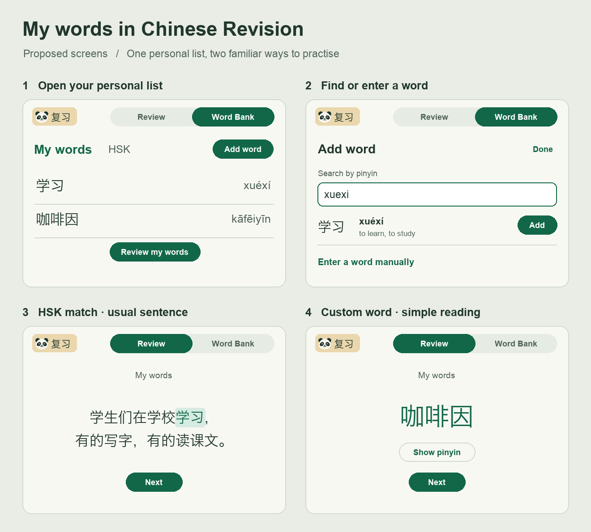

# My words in Chinese Revision

**Implementation plan · 21 November 2026.** Make the learner’s own vocabulary the first source for Review. Keep the existing HSK catalogue available for finding words and for further practice. Implemented locally. The mockup illustrates the design; the product and design specifications describe the delivered behaviour.

## The learner’s experience

1. **Open Word Bank.** Keep **Review** and **Word Bank** as the two main destinations. Inside Word Bank, open **My words** first, alongside **HSK**. The empty list says “Add a word from class to review it here” and offers **Add word**. The HSK level filter belongs to the HSK catalogue. Opening Review with an empty personal list continues the current HSK experience.
2. **Find and save.** **Add word** focuses the pinyin search. Typing `xuexi` finds 学习 · xuéxí · to learn, to study across the whole catalogue. Each result shows characters, tone-marked pinyin and its available meaning, so the learner can distinguish words that sound alike. Tap **Add** to change that row to **Added**. Keep the search open for the next word. **Done** returns to My words. When personal words are ready, **Review my words** starts them directly from that list.
3. **Fill a gap.** Offer **Enter a word manually** below the results, including when the search finds nothing. Carry the typed pinyin into a two-field form. Enter the Chinese characters, check the pinyin, and tap **Save word**. Keep the typed values if a field needs correction. A manual entry that matches a catalogue word offers that existing entry; ambiguous matches show their readings and meanings for selection.
4. **Practise as usual.** New prompts draw from due personal entries first, then unseen ones. If 学习 was added from HSK, it opens the existing highlighted sentence with lookup and **Next**. A custom entry such as 咖啡因 opens a simple word prompt. Say it aloud, tap **Show pinyin** if needed, then tap **Next**. The reading appears in place. Next works with or without revealing it and uses the existing scheduling rules.
5. **Choose whether to continue.** When the last personal word for today is credited, show **You’re caught up on My words** and one **Keep practising HSK** action. It switches to the saved HSK levels. Opening Review later with personal words all up to date offers the same choice. The existing daily bamboo count, celebrations at 10, 15 and 30, and one credit per distinct entry apply across both sources.

## UI and UX refinements

| Where friction occurs | Design decision |
|---|---|
| Pinyin can return several characters or senses. | Put characters, reading and a short catalogue meaning together at selection time. Keep exact readings distinct even when a toneless search returns both. |
| Adding several words in class can mean repeatedly reopening the form. | Keep search open, acknowledge the saved row, and allow the next search immediately. Announce the result to assistive technology without moving focus. |
| A teacher’s word may be missing even when search has near matches. | Keep manual entry visible on every search. Carry the query forward and let the learner correct tones without retyping the word. |
| A learner may wonder whether adding a second bank changes Review. | Keep sentence practice for catalogue words. Use the smaller prompt only for a word without a sentence. Keep Next in its familiar position and both actions keyboard accessible. |
| A typo or accidental add can persist in the personal list. | Open a personal entry to edit its custom spelling or reading, or **Remove from My words**. Removing a word changes membership. Re-adding the same entry restores its history and preserves today’s credit. Keep maintenance actions off the review screen. |
| A small class set can finish before the daily bamboo goal. | Give the personal list its own caught-up message. If finishing it triggers a bamboo celebration, show that celebration once; its existing Continue button returns to the caught-up state. |

## Build in this order

1. **Personal entries and safe persistence.** In [vocabulary.ts](../../../src/vocabulary.ts) and [storage.ts](../../../src/storage.ts), store catalogue membership by the existing entry key and give each custom entry a stable ID independent of editable text. Keep the bundled catalogue immutable. Introduce a versioned browser save that imports the current v4 format once and preserves selected HSK levels, history, credits, unfinished sentences and existing legacy migration behaviour. Restore personal entries before validating prompt IDs and history. Use a lock for the new save version, following the existing Web Lock pattern. Leave the old save intact so a still-open v4 tab cannot overwrite new records; reload older tabs to join the new session. Recheck duplicate adds under the lock. Extend the visit-only notice to include personal words. The list is local to this browser profile and clearing site data erases it.
2. **Word Bank and search.** Extend [main.ts](../../../src/main.ts) and the existing styles. Match pinyin case-insensitively, with or without tones and spaces; keep ü distinct from u. Retain the learner’s display spelling. Use tone-insensitive matching for discovery only. Resolve duplicates against characters and the intended reading or catalogue sense. Never select the first same-sounding result on the learner’s behalf. Give new inputs visible labels, support Chinese keyboard composition, and render user text safely in list rows, details, prompt text and bamboo tooltips. Restore focus and scroll when returning to a list.
3. **Review and the transition to HSK.** Extend [review.ts](../../../src/review.ts) to distinguish a sentence prompt from a word-only prompt, recording its session source alongside its kind and keeping existing prompt IDs, lookup tracking, Next and credit logic. Use the same eligibility rule for prompt selection and the caught-up screen: personal entries that are due or unseen and have yet to earn credit today. Filter before calling the chooser, since its current HSK behaviour can bring future words forward. Honour an unfinished prompt on normal resume. The existing app also preselects an HSK prompt at launch. **Review my words** explicitly switches to a personal prompt without crediting an abandoned HSK item, so the learner can start immediately after adding a first word. Resume the same prompt if it is already an eligible personal entry. Ordinary list edits never award credit or replace another word in progress. Removing the active personal entry retires its prompt without credit and picks the next eligible item. Ignore stale Next actions for the retired prompt. Preserve earned history and daily credit. Persist the explicit HSK continuation for the current local day so Next and refresh keep working. On a new day, select personal words first after any unfinished prompt. Update both automatic prompt creation and the current empty-review redirect to Word Bank. A caught-up state must survive reload without creating an HSK prompt. Supply custom display names to the shared bamboo renderer and celebrations.
4. **Verification and release.** Add focused scheduler, save-migration and browser checks to the existing suites. Run the unit suite, production build and Playwright regressions. Check the changed screens at phone width and on desktop, in both themes, with a Chinese input method and keyboard-only navigation. Update the product and design specifications after the implemented flow passes these checks.

## Acceptance cases

| Scenario | Expected result |
|---|---|
| Existing v4 save with an unfinished HSK sentence and saved levels | Upgrade and refresh preserve the sentence, its lookup flag, credits, history and levels. |
| Search `xuexi` while browsing HSK 3; add 学习 twice or from two tabs | The Level 1 match can be found. My words shows one entry; it opens its normal HSK sentence and keeps its prior review history. |
| First launch preselects HSK; add a personal word and tap Review my words | Personal review opens immediately. The preselected HSK entry earns no credit. Normal reload still restores a genuine unfinished prompt. |
| Enter a reading with multiple matches | Selection shows the relevant alternatives. Different readings and catalogue senses keep distinct histories. |
| Add 咖啡因 with kāfēiyīn, show its reading, refresh, then press Next | The same word prompt resumes. Next records one credit and schedules tomorrow. An unaided first review follows the existing three-day interval. |
| Correct a custom entry after reviewing it; remove an overlapping HSK entry | A spelling correction preserves the custom history. Removing the HSK membership leaves its catalogue entry and progress intact. |
| Finish the personal pool, reload, then select Keep practising HSK | The caught-up screen survives reload. HSK practice starts on request, skips entries already credited today, and resumes after refresh. |
| The last personal word is also the tenth distinct word today | The existing celebration appears once. Continue shows personal completion. Other milestone thresholds and daily rollover retain their existing behaviour. |
| An older tab writes v4 after migration; another current tab removes a custom word mid-review | The new save retains its data. Next on the retired prompt records no visit. Removing and re-adding a previously credited entry preserves its daily count. |
| Storage is unavailable, or another tab advances the same prompt | The visit-only message covers words and progress. With normal storage, concurrent Next actions credit only once. |

Implementation scope is the static browser app and its local save. The existing [product specification](../../../specification.md) and [design specification](../../design-spec.md) describe the baseline.

## Local verification

The production build, 14 unit tests and 36 Chrome browser tests passed. An additional desktop light-mode and phone-sized dark-mode walkthrough exercised the built app using isolated browser profiles. Existing-save migration, shared credits, the tenth-word celebration, personal completion, and continuation into HSK were verified. Chinese input composition was simulated in Chrome. Physical phone keyboards and public deployment remain unverified.

### Modern Web Guidance

- **Forms.** I used explicit labels for both entry fields and retained typed values during corrections, following the guidance to “use visible labels”.
- **Accessibility.** I added a polite save confirmation alongside the search results, following “Centralize live regions for non-visible announcements”.
